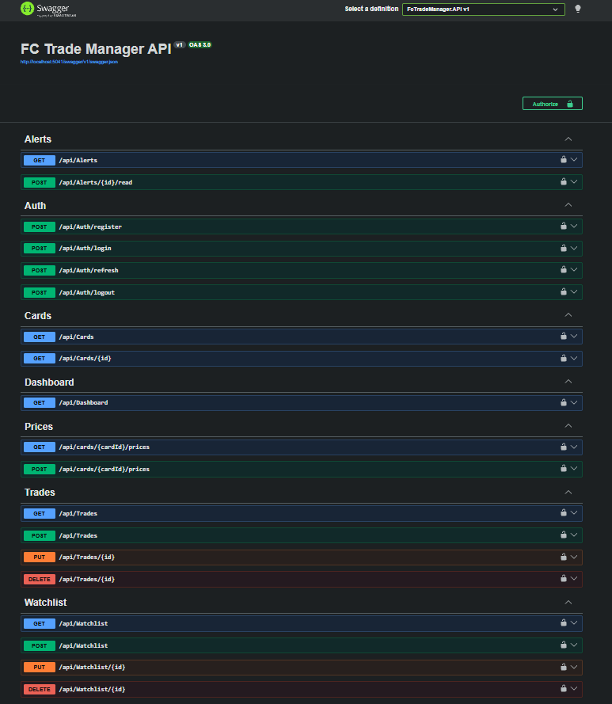
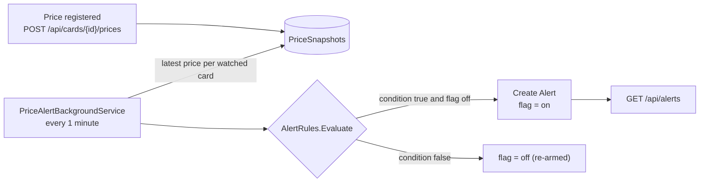
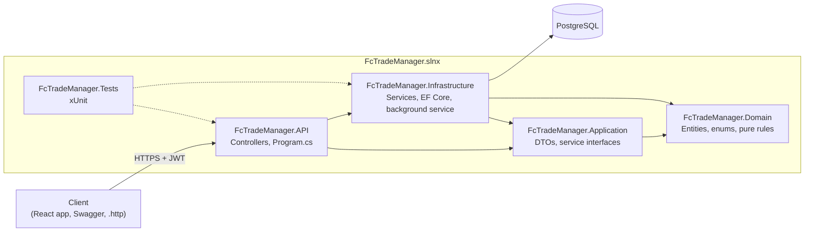
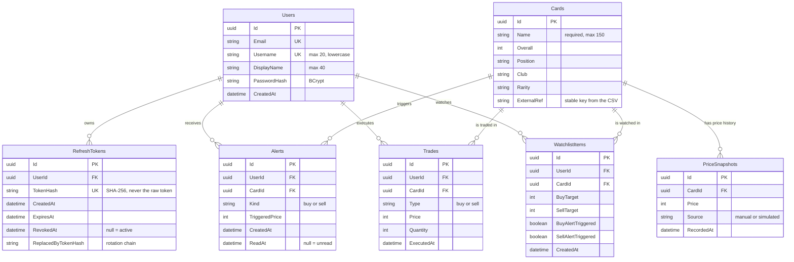
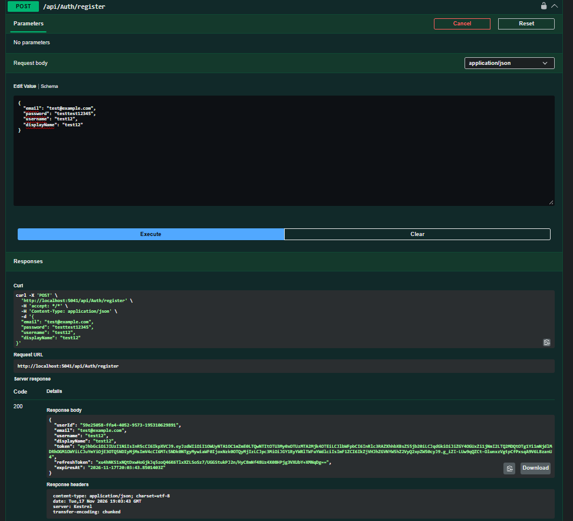
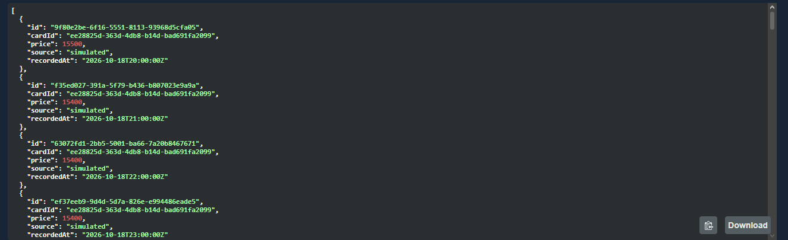

# FC Trade Manager — Backend

**English** | [Português (BR)](README.pt-BR.md)


[](https://github.com/fc-trade-manager/backend/actions/workflows/ci.yml)

REST API to track **EA SPORTS FC Ultimate Team** cards as a trading portfolio: keep a watchlist with target prices, store a price history, register buys and sells with the profit calculated **after the market fee**, and get **alerts** when a price reaches a target.

This is a portfolio project. The React front-end will live in a separate repository (planned).

> **Unofficial fan project.** It is not affiliated with, endorsed by or connected to Electronic Arts. The card catalog (`Data/cards.csv`) is **illustrative** and all simulated prices are fictional.

---

## Table of contents

- [Overview](#overview)
- [Main business decisions](#main-business-decisions)
- [Business rules](#business-rules)
- [Architecture](#architecture)
- [Database](#database)
- [API](#api)
- [Getting started](#getting-started)
- [Demo data (prices)](#demo-data-prices)
- [Testing and CI](#testing-and-ci)
- [Known limitations and roadmap](#known-limitations-and-roadmap)
- [Credits](#credits)

---

## Overview

| Module | What it does |
| --- | --- |
| Authentication | Register (e-mail, username, display name, password) and login; short-lived JWT access token plus rotating refresh token |
| Catalog | Cards loaded from a CSV, public search with filters and pagination |
| Prices | Price snapshots per card (`manual` or `simulated`) with 24h / 7d / 30d history |
| Watchlist | Cards with buy/sell targets, last price, 24h change and distance to each target |
| Trades | Buys and sells with profit calculated after the 5% fee; edit and delete with consistency checks |
| Dashboard | Total profit, best and worst sale, open positions |
| Alerts | A background service creates an alert when a target is reached |



## Main business decisions

The reasoning behind the rules (the rules themselves are listed in [Business rules](#business-rules)).

### 1. No external price source; prices are snapshots

There is no public API for Ultimate Team market prices, and EA's rules discourage third-party apps that access the game's servers. Scraping is fragile and may violate terms. So the system does not depend on an external source: every price is stored as an immutable **snapshot** (`Price`, `RecordedAt`, `Source`).

- `manual`: registered by a user through `POST /api/cards/{cardId}/prices`.
- `simulated`: fictional history created for development and demos by a separate script (see [Demo data](#demo-data-prices)). The column exists so simulated data can be told apart and replaced without ever touching manual prices.
- The "current price" of a card is always its **latest snapshot**, however old it is.

### 2. Profit follows the game's economy: 5% fee and average cost

Selling on the market costs 5% of the sale price, so a trade is only a gain if the net amount beats what was paid. Profit is calculated only for **sells**, using the **average buy price** of the buys made up to that moment (simple and predictable for a portfolio demo; FIFO or lot tracking was deliberately left out). A buy has `calculatedProfit = 0`. The dashboard sums only sells.

Worked example: buy 2 at 1,000 and 1 at 1,300 (average 1,100); sell 1 at 2,000 → net 1,900 → profit **800**.

### 3. A position can never be negative, at any point in time

You cannot sell what you do not have. Besides checking the present, the API checks the **whole timeline** of the card (buys first when timestamps tie). This matters because trades can be **edited or deleted**: deleting an old buy, or changing a sell's quantity, could make a later sell impossible. Every create/update/delete is simulated in memory and **validated before anything is saved**; if it breaks the timeline the API answers `400`.

The trade date (`executedAt`) is set by the server and is not editable, which keeps the timeline trustworthy.

### 4. Watchlist: one entry per card, targets must make sense

A card appears once per user (unique `(UserId, CardId)`; duplicate → `409`) and the buy target must be **lower** than the sell target. Targets and prices use the same range (200 to 15,000,000), which is the allowed price range of the game's market as modeled here (different rarities operate on different brackets, but this logic isn't considered on this demo for simplicty reasons).

### 5. Alerts fire once per crossing, not once per minute

A background service evaluates every watchlist item every minute against the latest price. Naively, an alert would be created every minute while the price stays below the target. Instead each item remembers whether each side is **currently triggered**:

- Buy side fires when `price <= buyTarget`; sell side fires when `price >= sellTarget`.
- It fires **only when the condition becomes true** (flag off → on). While it stays true, nothing new is created.
- When the price **comes back** across the target, the flag is cleared (re-armed) and a later crossing fires again.
- **Editing a target resets its flag**, so a new target can fire immediately if the price already satisfies it.
- The decision is a pure function (`Domain/Rules/AlertRules.cs`), so it is easy to unit test.



### 6. 24-hour change uses a fair baseline

The watchlist shows how much the price moved in 24h, in coins and percent. The baseline is the latest snapshot **from 24h ago or older**; if there is none but the last 24h has at least two snapshots, the oldest of the window is used; otherwise the change is `null` (not enough data, rather than a misleading `0`).

### 7. Authentication: short access token, rotating refresh token

- Access token (JWT, HS256): 15 minutes (60 in Development), zero clock skew.
- Refresh token: random 64 bytes, **only its SHA-256 hash is stored**; valid 7 days; **rotated** on every refresh (the old one is revoked and linked to the new one).
- **Reuse detection**: presenting an already-revoked refresh token is treated as theft and revokes **all** active tokens of that user.
- Passwords use BCrypt. E-mail and username are normalized to lowercase and are unique. Login is by **e-mail**.
- The JWT secret (≥ 32 bytes) and the connection string are required at startup (the app refuses to start without them) and are never kept in the repository.

### 8. Catalog: public, paged and seeded from a CSV

`GET /api/cards` is public (anyone can browse), paged (default 20, max 100) and ordered by name. The catalog is imported from `Data/cards.csv` **only when the `Cards` table is empty**, so restarts never duplicate or overwrite cards. Each card has an `ExternalRef` (e.g. `cards-030`): a **stable identifier that lives in the CSV**. The card `Id` (GUID) is generated on import and therefore differs in every database, so `ExternalRef` is what lets external tools, like the price script, refer to a card across databases.

### 9. Technical decisions worth knowing

- **Enums are stored as lowercase text** in the database (`buy`, `sell`, `manual`, `simulated`) and exposed as **camelCase strings** in JSON, never as numbers: readable data and a clear API contract.
- **Layered solution** (Domain ← Application ← Infrastructure ← API): rules live in the domain/services, controllers only translate HTTP.
- **Migrations are applied by the developer** (`dotnet ef database update`), not automatically at startup, to avoid surprise schema changes.
- **Swagger is enabled only in Development.** CORS origins come from configuration.

## Business rules

| Rule | Description |
| --- | --- |
| RN01 | Net value of a sale = sell price × 0.95 (the market keeps 5%). |
| RN02 | Profit of a sale = (net sell price − average buy price) × quantity. The average considers all buys of that card up to the time of the sale. |
| RN04 | The open position of a card can never be negative at any point in time; validated chronologically on create, edit and delete of trades. |
| RN05 | 24h change compares the last price with a baseline (see decision 6) and is returned in coins and percent. |
| RN06 | Buy alert when `price <= buyTarget`; sell alert when `price >= sellTarget`. |
| RN07 | An alert fires once per crossing; it is re-armed when the price comes back or when the user changes the target. |
| RN08 | Prices are between 200 and 15,000,000 coins; trade quantity between 1 and 100. |
| RN09 | A card appears once per watchlist and the buy target must be lower than the sell target. |

## Architecture

Dependencies point inward: the domain knows nothing about the other layers.



```
FcTradeManager.slnx
├── FcTradeManager.API/              Controllers, Program.cs, appsettings, Data/cards.csv, .http file
├── FcTradeManager.Application/      DTOs and service interfaces
├── FcTradeManager.Domain/           Entities, enums and pure rules (Rules/AlertRules.cs)
├── FcTradeManager.Infrastructure/   AppDbContext, migrations, services, BackgroundServices/
└── FcTradeManager.Tests/            xUnit project (support helpers; test cases still to be written)
```

| Area | Technology |
| --- | --- |
| Runtime | C# on .NET 10 |
| Web | ASP.NET Core Web API, Swashbuckle (Swagger) |
| Data | EF Core 10 + Npgsql, PostgreSQL |
| Auth | JWT Bearer, BCrypt.Net-Next |
| Background work | `BackgroundService` |
| Tests | xUnit, NSubstitute, EF Core SQLite in-memory |

## Database

PostgreSQL, managed with EF Core migrations. Money values are integers (in-game coins). Enum columns hold lowercase text.



| Table | Constraint or index | Purpose |
| --- | --- | --- |
| `Users` | Unique `Email`; unique `Username` | No duplicate accounts |
| `WatchlistItems` | Unique `(UserId, CardId)` | A card appears once per watchlist |
| `PriceSnapshots` | Index `(CardId, RecordedAt)` | Fast history and latest-price queries |
| `RefreshTokens` | Unique `TokenHash` | Lookup by hash; rotation and reuse detection |
| `Cards` | `Name` required, max 150 | Catalog integrity |

## API

Interactive docs at `/swagger` in the Development environment. JSON enums are camelCase strings (`"buy"`, `"sell"`, `"manual"`, `"simulated"`). Business errors return `{ "message": "..." }`; validation errors return the standard ASP.NET problem details (`400`).

### Endpoints

| Method | Route | Auth | Description |
| --- | --- | --- | --- |
| POST | `/api/auth/register` | No | Create an account; returns tokens |
| POST | `/api/auth/login` | No | Log in with e-mail and password |
| POST | `/api/auth/refresh` | No | Exchange a refresh token for a new pair |
| POST | `/api/auth/logout` | No | Revoke a refresh token (`204`) |
| GET | `/api/cards` | No | Search the catalog, paged |
| GET | `/api/cards/{id}` | Yes | One card |
| GET | `/api/cards/{cardId}/prices?period=24h` | Yes | Price history (`24h`, `7d`, `30d`) |
| POST | `/api/cards/{cardId}/prices` | Yes | Register a manual price |
| GET | `/api/watchlist?sortBy=name` | Yes | Watchlist with prices and variation (`name`, `price`, `change`) |
| POST | `/api/watchlist` | Yes | Add a card with targets |
| PUT | `/api/watchlist/{id}` | Yes | Change the targets (`{id}` is the watchlist item id) |
| DELETE | `/api/watchlist/{id}` | Yes | Remove from the watchlist (`204`) |
| GET | `/api/trades` | Yes | List trades with calculated profit, newest first |
| POST | `/api/trades` | Yes | Register a buy or sell |
| PUT | `/api/trades/{id}` | Yes | Edit a trade |
| DELETE | `/api/trades/{id}` | Yes | Delete a trade (`204`) |
| GET | `/api/dashboard` | Yes | Profit summary and open positions |
| GET | `/api/alerts` | Yes | List alerts, newest first |
| POST | `/api/alerts/{id}/read` | Yes | Mark an alert as read (`204`) |

`GET /api/cards` query parameters: `name` (contains), `overall` (minimum), `position`, `rarity`, `page` (default 1), `pageSize` (default 20, 1–100).



### Request bodies

| Endpoint | Body | Validation |
| --- | --- | --- |
| `POST /api/auth/register` | `{ "email", "password", "username", "displayName" }` | valid e-mail; password ≥ 8; username `[A-Za-z0-9_]`, 3–18; displayName 3–25 |
| `POST /api/auth/login` | `{ "email", "password" }` | required |
| `POST /api/auth/refresh` / `logout` | `{ "refreshToken" }` | required |
| `POST /api/cards/{cardId}/prices` | `{ "price" }` | 200–15,000,000 |
| `POST /api/watchlist` | `{ "cardId", "targetBuyPrice", "targetSellPrice" }` | both 200–15,000,000; buy < sell |
| `PUT /api/watchlist/{id}` | `{ "buyTarget", "sellTarget" }` | both 200–15,000,000; buy < sell |
| `POST` / `PUT /api/trades` | `{ "cardId", "type", "price", "quantity" }` | price 200–15,000,000; quantity 1–100; `type` is `buy` or `sell` |

> The watchlist create body uses `targetBuyPrice`/`targetSellPrice` while the update body uses `buyTarget`/`sellTarget`. This inconsistency is known and kept for now (the response uses `targetBuyPrice`/`targetSellPrice`).

### Responses (main shapes)

```jsonc
// auth (register / login / refresh)
{ "userId": "…", "email": "…", "username": "…", "displayName": "…",
  "token": "<JWT>", "refreshToken": "<opaque>", "expiresAt": "2026-11-13T14:00:00Z" }

// GET /api/cards
{ "items": [ { "id": "…", "name": "…", "overall": 91, "position": "ST",
               "club": "…", "rarity": "…", "externalRef": "cards-030" } ],
  "page": 1, "pageSize": 20, "totalItems": 156, "totalPages": 8 }

// GET /api/watchlist (item)
{ "id": "…", "cardId": "…", "cardName": "…", "overall": 91, "position": "ST",
  "club": "…", "rarity": "…", "targetBuyPrice": 55000, "targetSellPrice": 70000,
  "createdAt": "…", "lastPrice": 54000, "priceChange24h": -1500,
  "priceChangePercent24h": -2.7, "distanceToBuy": -1000, "distanceToSell": 16000 }

// GET /api/trades (item)
{ "id": "…", "cardId": "…", "cardName": "…", "type": "sell", "price": 2000,
  "quantity": 1, "calculatedProfit": 800.00, "executedAt": "…" }

// GET /api/dashboard
{ "totalProfit": 800.00, "bestTradeProfit": 800.00, "worstTradeProfit": 800.00,
  "openPositionsCount": 1, "openPositions": [ { "cardId": "…", "cardName": "…", "quantity": 2 } ] }

// GET /api/alerts (item)
{ "id": "…", "cardId": "…", "cardName": "…", "kind": "buy",
  "triggeredPrice": 54000, "createdAt": "…", "readAt": null }
```

`distanceToBuy` = last price − buy target (negative means already below the target); `distanceToSell` = sell target − last price.

## Getting started

### Prerequisites

- [.NET 10 SDK](https://dotnet.microsoft.com/download)
- PostgreSQL (local install or Docker, I reccomend Docker)
- EF Core CLI: `dotnet tool install --global dotnet-ef`

### 1. Clone

```bash
git clone https://github.com/fc-trade-manager/backend.git
cd backend
```

### 2. Configure secrets

The connection string and the JWT secret are **not** in the repository (the app will not start without them). Use .NET user secrets:

```bash
cd FcTradeManager.API
dotnet user-secrets set "ConnectionStrings:DefaultConnection" "Host=localhost;Database=fctrademanager;Username=postgres;Password=YOUR_PASSWORD"
dotnet user-secrets set "JwtSettings:Secret" "a-long-random-string-with-at-least-32-characters"
cd ..
```

In production use environment variables instead: `ConnectionStrings__DefaultConnection`, `JwtSettings__Secret`, `Cors__AllowedOrigins__0`.

| Setting | Default | Notes |
| --- | --- | --- |
| `JwtSettings:Issuer` / `Audience` | `FcTradeManager` / `FcTradeManagerClients` | |
| `JwtSettings:AccessTokenMinutes` | 15 (60 in Development) | |
| `JwtSettings:RefreshTokenDays` | 7 | |
| `Cors:AllowedOrigins` | `[]` (Development: `localhost:3000`, `localhost:5173`) | Add your front-end origin; in production an empty list logs a warning and browsers are blocked |

### 3. Create the database

```bash
dotnet ef database update --project FcTradeManager.Infrastructure --startup-project FcTradeManager.API
```

### 4. Run

```bash
cd FcTradeManager.API
dotnet run
```

Listens on `http://localhost:5041` (the `https` profile also uses `https://localhost:7185`). Swagger: `http://localhost:5041/swagger`.

On startup the catalog is imported from `Data/cards.csv` (copied to the build output) **only if `Cards` is empty**. Rows with fewer than 6 columns are skipped; the parser splits on `,`, so card names cannot contain commas.

### 5. Try it

`FcTradeManager.API/FcTradeManager.API.http` has ready-made requests. With `curl`:

```bash
# register (the response includes the tokens)
curl -X POST http://localhost:5041/api/auth/register -H "Content-Type: application/json" \
  -d '{"email":"me@example.com","password":"MyPassw0rd!","username":"me_trader","displayName":"Me Trader"}'

# find a card
curl "http://localhost:5041/api/cards?name=mbapp"

# add it to the watchlist
curl -X POST http://localhost:5041/api/watchlist -H "Authorization: Bearer <TOKEN>" -H "Content-Type: application/json" \
  -d '{"cardId":"<CARD_ID>","targetBuyPrice":1000,"targetSellPrice":2000}'

# register a manual price below the buy target
curl -X POST http://localhost:5041/api/cards/<CARD_ID>/prices -H "Authorization: Bearer <TOKEN>" -H "Content-Type: application/json" \
  -d '{"price":900}'
```

Within about a minute, `GET /api/alerts` shows a `buy` alert.

## Demo data (prices)

To have 30 days of charts from day one, a separate script generates simulated history: **`seed_prices.py`** (single file, no dependencies). It reads `cards.csv`, joins cards by `ExternalRef` and writes a `.sql` file that inserts snapshots with `Source = 'simulated'` (re-running replaces only simulated rows; manual prices are never touched).

For more info on how the script works, check its [repository](https://github.com/fc-trade-manager/price-seed-script). The script doesn't generate realistic prices, but instead populates the DB for the demos sake.



## Testing and CI

**Status: work in progress.** The `FcTradeManager.Tests` project is wired into the solution (xUnit, NSubstitute, EF Core SQLite in-memory) with support helpers (`TestDb`, `Seed`, `ControllerHelper`), but there are **no test cases yet**.

Tests have been planned already.

```bash
dotnet test
```

GitHub Actions (`.github/workflows/ci.yml`) restores, builds and tests on every push to `main` and on pull requests.

## Known limitations and roadmap

- **Prices are global** and any authenticated user can register them (acceptable for personal/demo use), but in future releases only the admin will be able to alter prices.
- **No real tests yet**. 
- Migrations are not applied automatically; there is no Docker Compose or `.env.example` yet. Once the frontend and test suite are finished this will be done.
- No rate limiting; expired/revoked refresh tokens are never purged.
- The CSV parser is minimal (comma split, no quoting).
- Alerts compare against the latest snapshot regardless of its age.
- Watchlist DTO field names differ between create and update (see [API](#api)).
- Not implemented: change password / delete account, e-mail or real-time notifications, CSV export.

Roadmap: tests, React front-end (separate repository), Docker Compose, API testing with Postman, deployment, live price simulation job.

## Credits

Author: [Mysterion147](https://github.com/Mysterion147) · License: [MIT](LICENSE)

The base of this documentation was generated by [Claude](https://claude.ai) (Anthropic) from the repository and the project requirements, and reviewed manually by the author.