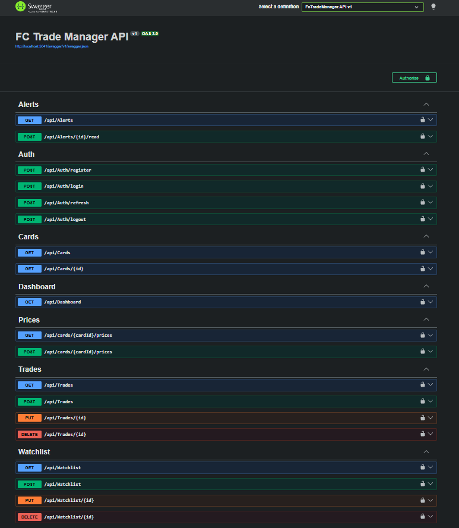
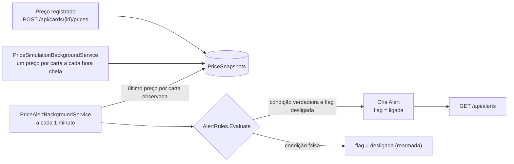
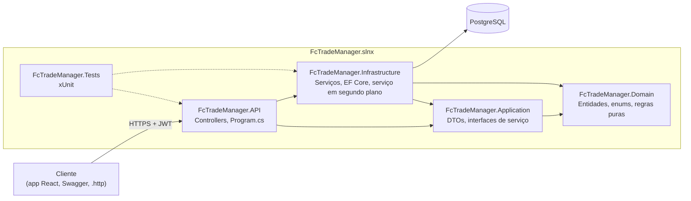
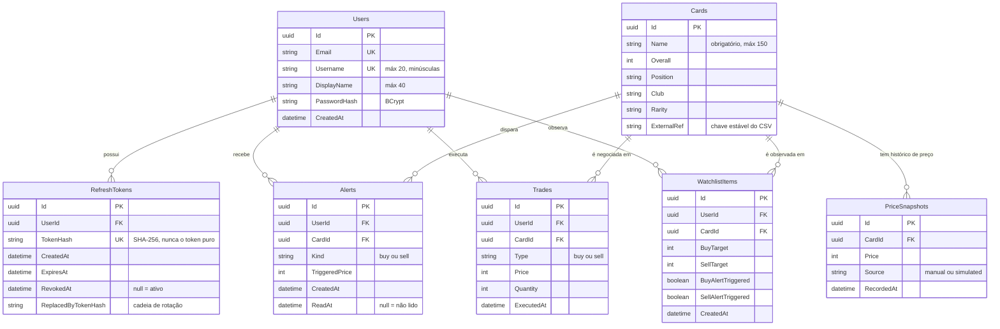
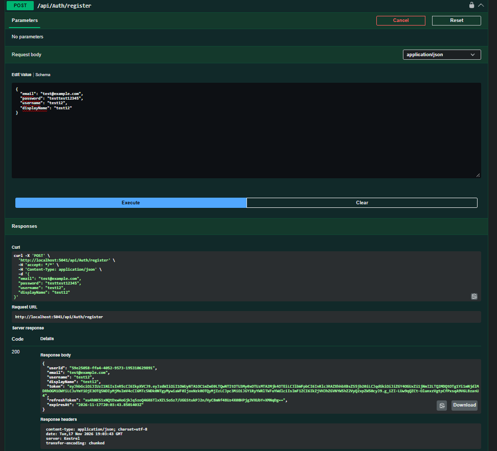
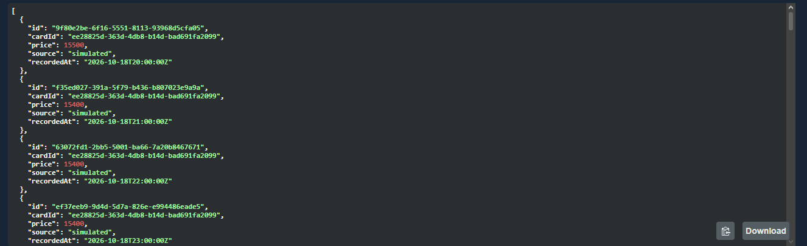

# FC Trade Manager — Backend

[English](README.md) | **Português (BR)**


[](https://github.com/fc-trade-manager/backend/actions/workflows/ci.yml)

API REST para acompanhar cartas do **EA SPORTS FC Ultimate Team** como uma carteira de trades: mantenha uma watchlist com preços-alvo, guarde o histórico de preços, registre compras e vendas com o lucro calculado **já descontada a taxa do mercado** e receba **alertas** quando um preço atinge a meta.

Projeto de portfólio. O front-end em React fica em outro repositório: [fc-trade-manager/frontend](https://github.com/fc-trade-manager/frontend).

> **Projeto de fã, não oficial.** Não tem afiliação, endosso ou ligação com a Electronic Arts. O catálogo de cartas (`Data/cards.csv`) é **ilustrativo** e todos os preços simulados são fictícios.

---

## Índice

- [Visão geral](#visão-geral)
- [Principais decisões de negócio](#principais-decisões-de-negócio)
- [Regras de negócio](#regras-de-negócio)
- [Arquitetura](#arquitetura)
- [Banco de dados](#banco-de-dados)
- [API](#api)
- [Como rodar](#como-rodar)
- [Dados de demonstração (preços)](#dados-de-demonstração-preços)
- [Testes e CI](#testes-e-ci)
- [Limitações conhecidas e roadmap](#limitações-conhecidas-e-roadmap)
- [Créditos](#créditos)

---

## Visão geral

| Módulo | O que faz |
| --- | --- |
| Autenticação | Cadastro (e-mail, nome de usuário, nome de exibição, senha) e login; JWT de curta duração com refresh token rotativo |
| Catálogo | Cartas carregadas de um CSV, busca pública com filtros e paginação |
| Preços | Snapshots de preço por carta (`manual` ou `simulated`) com histórico de 24h / 7d / 30d; o histórico simulado é mantido atualizado a cada hora enquanto a API roda |
| Watchlist | Cartas com metas de compra/venda, último preço, variação em 24h e distância até cada meta |
| Trades | Compras e vendas com lucro calculado após a taxa de 5%; editar e apagar com checagem de consistência |
| Dashboard | Lucro total, melhor e pior venda, posições abertas |
| Alertas | Um serviço em segundo plano cria um alerta quando uma meta é atingida |



## Principais decisões de negócio

O raciocínio por trás das regras (as regras em si estão em [Regras de negócio](#regras-de-negócio)).

### 1. Sem fonte externa de preços; preços são snapshots

Não existe API pública de preços de mercado do Ultimate Team, e as regras da EA desencorajam apps de terceiros que acessem os servidores do jogo. Scraping é frágil e pode violar termos. Por isso o sistema não depende de fonte externa: todo preço é guardado como um **snapshot** imutável (`Price`, `RecordedAt`, `Source`).

- `manual`: registrado por um usuário em `POST /api/cards/{cardId}/prices`.
- `simulated`: preços fictícios para desenvolvimento e demonstração. Os primeiros 30 dias são criados por um script separado (veja [Dados de demonstração](#dados-de-demonstração-preços)) e depois continuados pela própria API (veja a decisão 9). A coluna existe para distinguir e substituir os dados simulados sem nunca tocar nos preços manuais.
- O "preço atual" de uma carta é sempre o seu **último snapshot**, por mais antigo que seja.

### 2. O lucro segue a economia do jogo: taxa de 5% e preço médio

Vender no mercado custa 5% do valor da venda, então um trade só dá ganho se o valor líquido superar o que foi pago. O lucro é calculado apenas para **vendas**, usando o **preço médio de compra** das compras feitas até aquele momento (simples e previsível para uma demo de portfólio; FIFO ou controle por lote ficaram de fora de propósito). Uma compra tem `calculatedProfit = 0`. O dashboard soma somente as vendas.

Exemplo: compra 2 a 1.000 e 1 a 1.300 (média 1.100); vende 1 a 2.000 → líquido 1.900 → lucro **800**.

### 3. A posição nunca pode ficar negativa, em nenhum instante

Não dá para vender o que não se tem. Além do presente, a API confere a **linha do tempo inteira** da carta (compras primeiro quando os horários empatam). Isso importa porque os trades podem ser **editados ou apagados**: apagar uma compra antiga, ou mudar a quantidade de uma venda, poderia tornar impossível uma venda posterior. Toda criação/edição/exclusão é simulada em memória e **validada antes de salvar**; se quebrar a linha do tempo, a API responde `400`.

A data do trade (`executedAt`) é definida pelo servidor e não é editável, o que mantém a linha do tempo confiável.

### 4. Watchlist: uma entrada por carta, metas coerentes

Uma carta aparece uma vez por usuário (único `(UserId, CardId)`; duplicada → `409`) e a meta de compra deve ser **menor** que a de venda. Metas e preços usam a mesma faixa (200 a 15.000.000), a faixa de preços aceita no mercado conforme modelada aqui (raridades diferentes operam em faixas diferentes, mas essa lógica não é considerada nesta demo por simplicidade).

### 5. Alertas disparam uma vez por cruzamento, não uma vez por minuto

Um serviço em segundo plano avalia cada item da watchlist a cada minuto contra o último preço. De forma ingênua, um alerta seria criado todo minuto enquanto o preço ficasse abaixo da meta. Em vez disso, cada item lembra se cada lado está **atualmente disparado**:

- O lado de compra dispara com `preço <= metaCompra`; o de venda, com `preço >= metaVenda`.
- Dispara **somente quando a condição passa a ser verdadeira** (flag desligada → ligada). Enquanto continuar verdadeira, nada novo é criado.
- Quando o preço **volta** para o outro lado da meta, a flag é limpa (rearmada) e um novo cruzamento dispara de novo.
- **Editar uma meta zera a flag dela**, então uma meta nova pode disparar na hora se o preço já a satisfizer.
- A decisão é uma função pura (`Domain/Rules/AlertRules.cs`), fácil de testar.



### 6. A variação de 24h usa uma referência justa

A watchlist mostra quanto o preço variou em 24h, em moedas e em porcentagem. A referência é o último snapshot **de 24h atrás ou mais antigo**; se não houver, mas as últimas 24h tiverem ao menos dois snapshots, usa-se o mais antigo da janela; caso contrário a variação é `null` (dados insuficientes, em vez de um `0` enganoso).

### 7. Autenticação: access token curto, refresh token rotativo

- Access token (JWT, HS256): 15 minutos (60 em Development), sem tolerância de relógio.
- Refresh token: 64 bytes aleatórios, **só o hash SHA-256 é guardado**; válido por 7 dias; **rotacionado** a cada refresh (o antigo é revogado e ligado ao novo).
- **Detecção de reuso**: apresentar um refresh token já revogado é tratado como roubo e revoga **todos** os tokens ativos daquele usuário.
- Senhas com BCrypt. E-mail e nome de usuário são normalizados para minúsculas e são únicos. O login é por **e-mail**.
- O segredo do JWT (≥ 32 bytes) e a connection string são obrigatórios na inicialização (a app se recusa a subir sem eles) e nunca ficam no repositório.

### 8. Catálogo: público, paginado e carregado de um CSV

`GET /api/cards` é público (qualquer um navega), paginado (padrão 20, máx. 100) e ordenado por nome. O catálogo é importado de `Data/cards.csv` **somente quando a tabela `Cards` está vazia**, então reiniciar nunca duplica nem sobrescreve cartas. Cada carta tem um `ExternalRef` (ex.: `cards-030`): um **identificador estável que vive no CSV**. O `Id` (GUID) é gerado na importação e por isso muda em cada banco; o `ExternalRef` é o que permite a ferramentas externas, como o script de preços, referenciar uma carta entre bancos.

### 9. Simulação de preços ao vivo atrás de `IPriceProvider`

Os preços automáticos vêm de uma fonte escondida atrás da interface `IPriceProvider` (RF15). Hoje a única implementação é a `SimulatedPriceProvider`; uma fonte externa legítima seria uma nova implementação, sem mudar o resto do sistema.

- O script cria os primeiros 30 dias (um preço por hora). O `PriceSimulationBackgroundService` **continua** esse histórico: ao iniciar, preenche cada hora entre o último preço simulado de cada carta e a hora atual (no máximo 30 dias) e, depois, cria um novo preço por carta a cada hora cheia (UTC) enquanto a API está rodando.
- Ele continua a partir dos dados, não de uma fórmula. O "nível normal" de uma carta é a média dos últimos 7 dias de preços simulados (sem a alta de sexta); o próximo preço é esse nível, mais a alta de sexta, mais um pequeno ruído que lembra a hora anterior. Assim, o primeiro preço novo fica perto do último, e um preço fixado com a opção `end` do script continua coerente.
- A mesma carta e a mesma hora sempre dão o mesmo preço (sem estado aleatório escondido), então gerar uma hora duas vezes nunca cria dois valores diferentes.
- **RN10, o manual prevalece.** O serviço nunca cria um preço simulado em um minuto que já tenha um manual, e o histórico de preços esconde o simulado quando existe um manual no mesmo minuto.
- Cartas que ainda não têm histórico simulado são ignoradas: o script continua sendo o jeito de criar o histórico inicial.
- O preço atual é o último snapshot de qualquer origem, então um preço manual é o preço atual só até a próxima hora simulada.
- O modelo é uma função pura (`Domain/Rules/PriceSimulationRules.cs`), como as regras de alerta. Pode ser desligado com `PriceSimulation:Enabled` (veja [Como rodar](#como-rodar)).

### 10. Decisões técnicas que vale conhecer

- **Enums são gravados como texto em minúsculas** no banco (`buy`, `sell`, `manual`, `simulated`) e expostos como **strings camelCase** no JSON, nunca como números: dados legíveis e contrato claro.
- **Solução em camadas** (Domain ← Application ← Infrastructure ← API): as regras ficam no domínio/serviços; os controllers só traduzem HTTP.
- **As migrations são aplicadas pelo desenvolvedor** (`dotnet ef database update`), não automaticamente na inicialização, para evitar mudanças de schema por surpresa.
- **Swagger só em Development.** As origens do CORS vêm da configuração.

## Regras de negócio

| Regra | Descrição |
| --- | --- |
| RN01 | Valor líquido de uma venda = preço de venda × 0,95 (o mercado fica com 5%). |
| RN02 | Lucro de uma venda = (preço líquido − preço médio de compra) × quantidade. A média considera todas as compras daquela carta até o momento da venda. |
| RN03 | Lucro total = soma do lucro de todas as vendas (compras contam como zero). |
| RN04 | A posição aberta de uma carta nunca pode ser negativa em nenhum instante; validada cronologicamente ao criar, editar e apagar trades. |
| RN05 | A variação de 24h compara o último preço com uma referência (veja decisão 6) e é devolvida em moedas e em porcentagem. |
| RN06 | Alerta de compra quando `preço <= metaCompra`; alerta de venda quando `preço >= metaVenda`. |
| RN07 | Um alerta dispara uma vez por cruzamento; é rearmado quando o preço volta ou quando o usuário muda a meta. |
| RN08 | Preços entre 200 e 15.000.000 moedas; quantidade de trade entre 1 e 100. |
| RN09 | Uma carta aparece uma vez por watchlist e a meta de compra deve ser menor que a de venda. |
| RN10 | Um preço manual prevalece sobre o simulado no mesmo minuto (veja a decisão 9). |

## Arquitetura

As dependências apontam para dentro: o domínio não conhece as outras camadas.



```
FcTradeManager.slnx
├── FcTradeManager.API/              Controllers, Program.cs, appsettings, Data/cards.csv, arquivo .http
├── FcTradeManager.Application/      DTOs e interfaces de serviço (incluindo IPriceProvider)
├── FcTradeManager.Domain/           Entidades, enums e regras puras (Rules/AlertRules.cs, Rules/PriceSimulationRules.cs)
├── FcTradeManager.Infrastructure/   AppDbContext, migrations, serviços, SimulatedPriceProvider, BackgroundServices/
└── FcTradeManager.Tests/            testes unitários xUnit (regras, serviços, DTOs, constraints do banco, serviços em segundo plano)
```

| Área | Tecnologia |
| --- | --- |
| Runtime | C# no .NET 10 |
| Web | ASP.NET Core Web API, Swashbuckle (Swagger) |
| Dados | EF Core 10 + Npgsql, PostgreSQL |
| Autenticação | JWT Bearer, BCrypt.Net-Next |
| Trabalho em segundo plano | `BackgroundService` (alertas de preço, simulação de preços ao vivo) |
| Testes | xUnit, NSubstitute, EF Core SQLite em memória |

## Banco de dados

PostgreSQL, gerenciado com migrations do EF Core. Valores monetários são inteiros (moedas do jogo). Colunas de enum guardam texto em minúsculas.



| Tabela | Restrição ou índice | Finalidade |
| --- | --- | --- |
| `Users` | `Email` único; `Username` único | Sem contas duplicadas |
| `WatchlistItems` | Único `(UserId, CardId)` | Uma carta por watchlist |
| `PriceSnapshots` | Índice `(CardId, RecordedAt)` | Consultas rápidas de histórico e último preço |
| `RefreshTokens` | `TokenHash` único | Busca por hash; rotação e detecção de reuso |
| `Cards` | `Name` obrigatório, máx. 150 | Integridade do catálogo |

## API

Documentação interativa em `/swagger` no ambiente Development. Enums no JSON são strings camelCase (`"buy"`, `"sell"`, `"manual"`, `"simulated"`). Erros de negócio devolvem `{ "message": "..." }`; erros de validação devolvem o problem details padrão do ASP.NET (`400`).

### Endpoints

| Método | Rota | Auth | Descrição |
| --- | --- | --- | --- |
| POST | `/api/auth/register` | Não | Cria uma conta; devolve os tokens |
| POST | `/api/auth/login` | Não | Login com e-mail e senha |
| POST | `/api/auth/refresh` | Não | Troca um refresh token por um novo par |
| POST | `/api/auth/logout` | Não | Revoga um refresh token (`204`) |
| GET | `/api/cards` | Não | Busca no catálogo, paginada |
| GET | `/api/cards/{id}` | Sim | Uma carta |
| GET | `/api/cards/{cardId}/prices?period=24h` | Sim | Histórico de preços (`24h`, `7d`, `30d`); um preço manual esconde o simulado no mesmo minuto (RN10) |
| POST | `/api/cards/{cardId}/prices` | Sim | Registra um preço manual |
| GET | `/api/watchlist?sortBy=name` | Sim | Watchlist com preços e variação (`name`, `price`, `change`) |
| POST | `/api/watchlist` | Sim | Adiciona uma carta com metas |
| PUT | `/api/watchlist/{id}` | Sim | Altera as metas (`{id}` é o id do item da watchlist) |
| DELETE | `/api/watchlist/{id}` | Sim | Remove da watchlist (`204`) |
| GET | `/api/trades` | Sim | Lista trades com lucro calculado, mais recentes primeiro |
| POST | `/api/trades` | Sim | Registra uma compra ou venda |
| PUT | `/api/trades/{id}` | Sim | Edita um trade |
| DELETE | `/api/trades/{id}` | Sim | Apaga um trade (`204`) |
| GET | `/api/dashboard` | Sim | Resumo de lucro e posições abertas |
| GET | `/api/alerts` | Sim | Lista alertas, mais recentes primeiro |
| POST | `/api/alerts/{id}/read` | Sim | Marca um alerta como lido (`204`) |

Parâmetros de `GET /api/cards`: `name` (contém), `overall` (mínimo), `position`, `rarity`, `page` (padrão 1), `pageSize` (padrão 20, 1–100).



### Corpos das requisições

| Endpoint | Corpo | Validação |
| --- | --- | --- |
| `POST /api/auth/register` | `{ "email", "password", "username", "displayName" }` | e-mail válido; senha ≥ 8; username `[A-Za-z0-9_]`, 3–18; displayName 3–25 |
| `POST /api/auth/login` | `{ "email", "password" }` | obrigatórios |
| `POST /api/auth/refresh` / `logout` | `{ "refreshToken" }` | obrigatório |
| `POST /api/cards/{cardId}/prices` | `{ "price" }` | 200–15.000.000 |
| `POST /api/watchlist` | `{ "cardId", "targetBuyPrice", "targetSellPrice" }` | ambos 200–15.000.000; compra < venda |
| `PUT /api/watchlist/{id}` | `{ "buyTarget", "sellTarget" }` | ambos 200–15.000.000; compra < venda |
| `POST` / `PUT /api/trades` | `{ "cardId", "type", "price", "quantity" }` | preço 200–15.000.000; quantidade 1–100; `type` é `buy` ou `sell` |

> O corpo de criação da watchlist usa `targetBuyPrice`/`targetSellPrice`, enquanto o de atualização usa `buyTarget`/`sellTarget`. A inconsistência é conhecida e foi mantida por ora (a resposta usa `targetBuyPrice`/`targetSellPrice`).

### Respostas (formatos principais)

```jsonc
// auth (register / login / refresh)
{ "userId": "…", "email": "…", "username": "…", "displayName": "…",
  "token": "<JWT>", "refreshToken": "<opaco>", "expiresAt": "2026-11-13T14:00:00Z" }

// GET /api/cards
{ "items": [ { "id": "…", "name": "…", "overall": 91, "position": "ST",
               "club": "…", "rarity": "…", "externalRef": "cards-030" } ],
  "page": 1, "pageSize": 20, "totalItems": 156, "totalPages": 8 }

// GET /api/watchlist (item)
{ "id": "…", "cardId": "…", "cardName": "…", "overall": 91, "position": "ST",
  "club": "…", "rarity": "…", "targetBuyPrice": 55000, "targetSellPrice": 70000,
  "createdAt": "…", "lastPrice": 54000, "priceChange24h": -1500,
  "priceChangePercent24h": -2.7, "distanceToBuy": -1000, "distanceToSell": 16000 }

// GET /api/trades (item)
{ "id": "…", "cardId": "…", "cardName": "…", "type": "sell", "price": 2000,
  "quantity": 1, "calculatedProfit": 800.00, "executedAt": "…" }

// GET /api/dashboard
{ "totalProfit": 800.00, "bestTradeProfit": 800.00, "worstTradeProfit": 800.00,
  "openPositionsCount": 1, "openPositions": [ { "cardId": "…", "cardName": "…", "quantity": 2 } ] }

// GET /api/alerts (item)
{ "id": "…", "cardId": "…", "cardName": "…", "kind": "buy",
  "triggeredPrice": 54000, "createdAt": "…", "readAt": null }
```

`distanceToBuy` = último preço − meta de compra (negativo significa já abaixo da meta); `distanceToSell` = meta de venda − último preço.

## Como rodar

### Pré-requisitos

- [.NET 10 SDK](https://dotnet.microsoft.com/download)
- PostgreSQL (instalação local ou Docker; recomendo o Docker)
- CLI do EF Core: `dotnet tool install --global dotnet-ef`

### 1. Clonar

```bash
git clone https://github.com/fc-trade-manager/backend.git
cd backend
```

### 2. Configurar os segredos

A connection string e o segredo do JWT **não** ficam no repositório (a app não sobe sem eles). Use user secrets do .NET:

```bash
cd FcTradeManager.API
dotnet user-secrets set "ConnectionStrings:DefaultConnection" "Host=localhost;Database=fctrademanager;Username=postgres;Password=SUA_SENHA"
dotnet user-secrets set "JwtSettings:Secret" "uma-string-aleatoria-longa-com-pelo-menos-32-caracteres"
cd ..
```

Em produção, use variáveis de ambiente: `ConnectionStrings__DefaultConnection`, `JwtSettings__Secret`, `Cors__AllowedOrigins__0`.

| Configuração | Padrão | Observações |
| --- | --- | --- |
| `JwtSettings:Issuer` / `Audience` | `FcTradeManager` / `FcTradeManagerClients` | |
| `JwtSettings:AccessTokenMinutes` | 15 (60 em Development) | |
| `JwtSettings:RefreshTokenDays` | 7 | |
| `PriceSimulation:Enabled` | `true` | Desliga a geração de preços ao vivo (o script e os preços manuais continuam funcionando) |
| `PriceSimulation:FridayBoost` | `true` | Alta de sexta (+8%, caindo até segunda) para cartas com overall ≥ 86, como no script |
| `Cors:AllowedOrigins` | `[]` (Development: `localhost:3000`, `localhost:5173`) | Adicione a origem do seu front; em produção uma lista vazia gera um aviso e os navegadores são bloqueados |

### 3. Criar o banco

```bash
dotnet ef database update --project FcTradeManager.Infrastructure --startup-project FcTradeManager.API
```

### 4. Executar

```bash
cd FcTradeManager.API
dotnet run
```

Escuta em `http://localhost:5041` (o perfil `https` também usa `https://localhost:7185`). Swagger: `http://localhost:5041/swagger`.

Na inicialização o catálogo é importado de `Data/cards.csv` (copiado para a saída do build) **somente se `Cards` estiver vazia**. Linhas com menos de 6 colunas são ignoradas; o parser separa por `,`, então nomes de cartas não podem conter vírgula.

### 5. Experimentar

`FcTradeManager.API/FcTradeManager.API.http` tem requisições prontas. Com `curl`:

```bash
# cadastrar (a resposta inclui os tokens)
curl -X POST http://localhost:5041/api/auth/register -H "Content-Type: application/json" \
  -d '{"email":"eu@exemplo.com","password":"MinhaSenh4!","username":"eu_trader","displayName":"Eu Trader"}'

# achar uma carta
curl "http://localhost:5041/api/cards?name=mbapp"

# adicionar à watchlist
curl -X POST http://localhost:5041/api/watchlist -H "Authorization: Bearer <TOKEN>" -H "Content-Type: application/json" \
  -d '{"cardId":"<CARD_ID>","targetBuyPrice":1000,"targetSellPrice":2000}'

# registrar um preço manual abaixo da meta de compra
curl -X POST http://localhost:5041/api/cards/<CARD_ID>/prices -H "Authorization: Bearer <TOKEN>" -H "Content-Type: application/json" \
  -d '{"price":900}'
```

Em cerca de um minuto, `GET /api/alerts` mostra um alerta `buy`.

## Dados de demonstração (preços)

Para ter 30 dias de gráficos desde o primeiro dia, um script separado gera o histórico simulado: **`seed_prices.py`** (arquivo único, sem dependências). Ele lê o `cards.csv`, liga as cartas pelo `ExternalRef` e escreve um `.sql` que insere snapshots com `Source = 'simulated'` (rodar de novo substitui só as linhas simuladas; preços manuais nunca são tocados).

Para mais informações sobre como o script funciona, veja o [repositório dele](https://github.com/fc-trade-manager/price-seed-script). O script não gera preços realistas: ele serve para popular o banco para as demonstrações.

O script serve para o histórico **inicial**. Depois que ele roda, a API mantém esse histórico atualizado sozinha: ao iniciar, as horas que faltam são criadas automaticamente e, em seguida, um novo preço por carta a cada hora cheia (veja a decisão 9). Rodar o script de novo substitui todas as linhas simuladas (preços manuais nunca são tocados), então use-o para a primeira carga ou para recomeçar.



## Testes e CI

Os testes unitários ficam em `FcTradeManager.Tests` (xUnit, NSubstitute, EF Core SQLite em memória). Cada teste ganha seu próprio banco em memória, então **não é preciso PostgreSQL** para rodá-los.

| Pasta | O que cobre |
| --- | --- |
| `Rules/` | Regras puras: `AlertRules` (RN06, RN07) e `PriceSimulationRules` (horas cheias, alta de sexta, arredondamento, estado lido do histórico) |
| `Services/` | Autenticação, trades e cálculo de lucro, watchlist, preços (incluindo a RN10 no histórico), alertas, carga do catálogo, `SimulatedPriceProvider` |
| `BackgroundServices/` | `PriceAlertBackgroundService` (um ciclo por vez) e `PriceSimulationBackgroundService` (preenchimento de lacunas, sem duplicar, limite de 30 dias, RN10) |
| `Data/` | Constraints do banco (índices únicos, campos obrigatórios) |
| `Dtos/` | Atributos de validação (faixas da RN08, nome de usuário e de exibição) |

Suítes de API (Postman), ponta a ponta (Playwright) e de performance (k6) estão planejadas em repositórios separados; veja a [página da organização](https://github.com/fc-trade-manager).

```bash
dotnet test
```

O GitHub Actions (`.github/workflows/ci.yml`) restaura, compila e testa a cada push na `main` e em pull requests.

## Limitações conhecidas e roadmap

- **Os preços são globais** e qualquer usuário autenticado pode registrá-los (aceitável para uso pessoal/demo), mas em versões futuras só o admin poderá alterar preços.
- As migrations não são aplicadas automaticamente; ainda não há Docker Compose nem `.env.example` (planejado).
- Sem rate limiting; refresh tokens expirados/revogados nunca são removidos.
- O parser de CSV é mínimo (separa por vírgula, sem aspas).
- Alertas comparam com o último snapshot, qualquer que seja sua idade.
- Os nomes dos campos da watchlist diferem entre criação e atualização (veja [API](#api)).
- Os preços simulados são gerados para toda carta que tenha histórico simulado, não só para as da watchlist.
- As opções `noise` e `boost` por carta do script não são conhecidas pelo gerador ao vivo; use `PriceSimulation:FridayBoost` para desligar a alta de sexta em todas as cartas.
- Não implementado: trocar senha / excluir conta, notificações por e-mail ou em tempo real, exportar CSV.

Roadmap: Docker Compose, health check e logs estruturados, testes de API com Postman, suítes ponta a ponta (Playwright) e de performance (k6) em repositórios separados, deploy público.

## Créditos

Autor: [Mysterion147](https://github.com/Mysterion147) · Licença: [MIT](LICENSE)

A base desta documentação foi gerada pelo [Claude](https://claude.ai) (Anthropic) a partir do repositório e dos requisitos do projeto, e revisada manualmente pelo autor.
